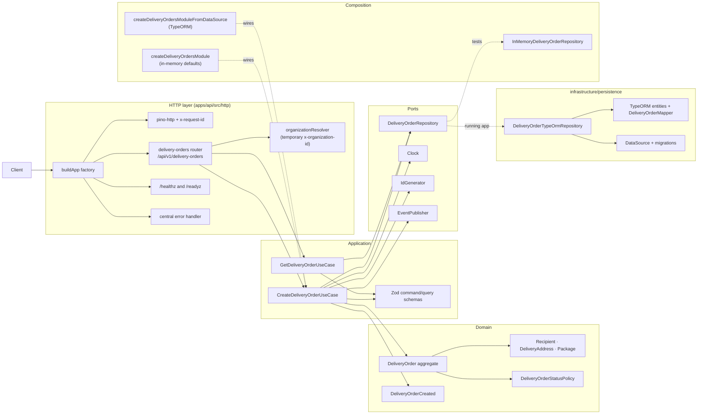
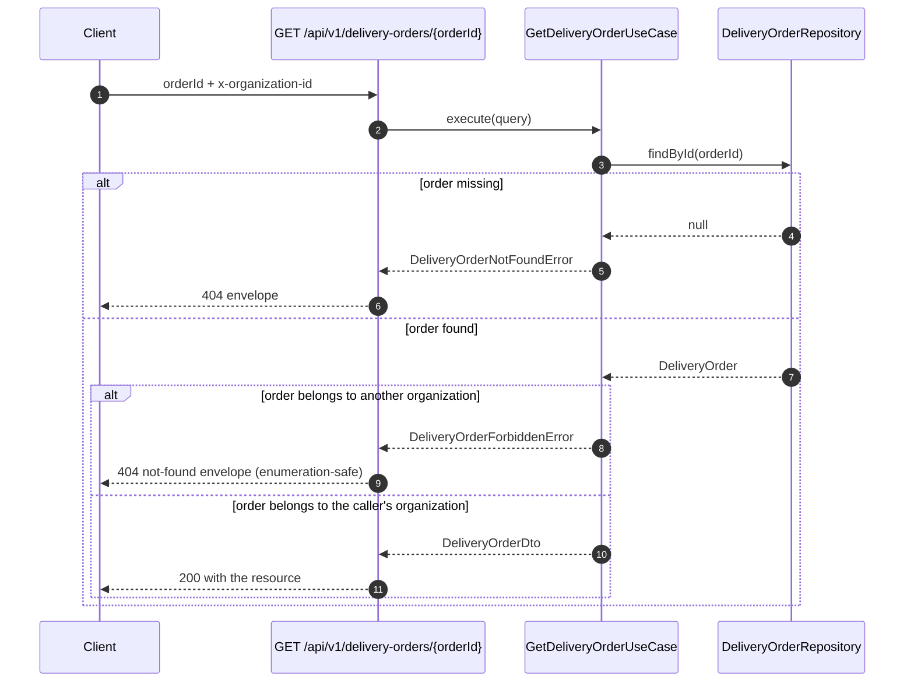

# Architecture — `delivery-orders`

The module is one hexagonal slice inside the modular monolith: a pure-TypeScript domain,
application use cases that depend on ports, and adapters supplied by composition. It is
implemented end to end: the Express 5 HTTP layer calls the use cases, PostgreSQL persists
the aggregate through TypeORM, and migrations create the schema. No framework type reaches
the domain, and no use case constructs its own dependencies.

## Layers

| Layer | Contents | May import |
|---|---|---|
| Domain | `DeliveryOrder`, value objects, status policy, domain event, typed errors | Shared pure helpers (`ids`, `errors`) only |
| Application | Create/get use cases, Zod command/query schemas, DTOs, ports | Domain, Node built-ins, Zod at the boundary |
| Infrastructure | TypeORM entities, mapper and repository in `infrastructure/persistence`; Express adapters in `apps/api/src/http` | Application ports, domain types, framework libraries |
| Composition | In-memory wiring for tests, TypeORM wiring for the process, process boot in `apps/api/src/main.ts` | Ports, use cases, adapters, shared helpers |

Dependencies point inward. The domain never imports Zod, Express, TypeORM or an HTTP
client (ADR-001 rule 1); use cases never import a concrete adapter (rule 2). TypeORM lives
only in `infrastructure/persistence`; Express lives only in `apps/api/src/http`.

## Components



## HTTP layer

`apps/api/src/http/app.ts` exports `buildApp({ deliveryOrders, readiness, logger })`. It
receives already-composed ports, reads no configuration and opens no connections, so HTTP
tests build the real Express app with in-memory adapters. `apps/api/src/main.ts` is the
process composition root.

Middleware order is fixed: request logger (establishes `x-request-id` before anything can
fail), JSON body parser with a `100kb` limit, health routes, the delivery-orders router,
the terminal not-found handler and the central error handler. Express 5 forwards rejected
async handlers to that error handler without an extra wrapper.

| Method | Path | Behavior |
|---|---|---|
| `POST` | `/api/v1/delivery-orders` | Zod-validated body, organization from request context, `201` plus `Location` |
| `GET` | `/api/v1/delivery-orders?publicCode=...` | Tenant-scoped code lookup, then the regular read use case |
| `GET` | `/api/v1/delivery-orders/:orderId` | Read by internal UUID; cross-organization access is an indistinguishable `404` |

The tenant is established by `organizationResolver`, which reads a UUID from the
**temporary** `x-organization-id` header and stores it in the request context. This is a
Fase 0 development adapter, not authentication: any caller can claim any organization.
Fase 1 replaces it with verified JWT claims (ADR-003) and the use cases stay unchanged. The
organization is never read from the body, path or query; the create body schema rejects an
`organizationId` field.

Responses and failures:

- Every request gets an `x-request-id`. A safe incoming value is honored; otherwise the
  API generates a UUIDv4. The same value is echoed and repeated as `error.correlationId`.
- Every non-2xx business response uses one envelope:
  `{ "error": { "code", "message", "details?", "correlationId" } }`.
- Validation → `400` with field-level details; unknown resource/route → `404`; invariant or
  duplicate public code → `409`; unexpected failure → `500` with a generic message and an
  error log. `DeliveryOrderForbiddenError` maps to the not-found envelope so a cross-tenant
  probe cannot confirm that an order exists.
- pino writes structured JSON logs in America/Lima time and redacts `Authorization`,
  cookies and token headers. Request bodies are not logged (ADR-005).
- `/healthz` is liveness and never touches PostgreSQL. `/readyz` runs an injected
  `SELECT 1`, returns `200 ready` or `503 not_ready`, and keeps probe error details in logs.
  Both are status documents, not error envelopes.

`docs/api/openapi.yaml` is the HTTP source of truth; the module overview is in
[api-contracts.md](api-contracts.md). ADR-004 records the versioning and error-mapping
decisions.

## Persistence

TypeORM is used in Data Mapper mode. The domain aggregate is never a TypeORM entity:

| Concern | Location |
|---|---|
| Pure aggregate and value objects | `domain/` |
| TypeORM entities (`delivery_orders`, `delivery_order_packages`) | `infrastructure/persistence/entities/` |
| Explicit domain ↔ entity mapping | `infrastructure/persistence/mappers/DeliveryOrderMapper.ts` |
| Repository port | `application/ports/DeliveryOrderRepository.ts` |
| PostgreSQL adapter | `infrastructure/persistence/DeliveryOrderTypeOrmRepository.ts` |

`apps/api/src/infrastructure/database/data-source.ts` builds the process-wide `DataSource`
from `DATABASE_URL` or the discrete `POSTGRES_*` variables. It sets `synchronize: false`,
`migrationsRun: false`, loads `apps/api/migrations/*.ts` and pins every session to
`America/Lima`; `timestamptz` columns store absolute instants regardless of session
rendering (ADR-002, ADR-007).

The initial migration
(`apps/api/migrations/1793073274116-InitialDeliveryOrders.ts`) creates both tables with
UUID keys, `timestamptz` timestamps, per-organization public-code uniqueness, package
ordering and coordinate/weight check constraints. Migrations are a one-shot process — the
Compose `migrations` service or the CI integration job — and never run on API boot.

The adapter:

- saves the whole aggregate in one TypeORM transaction (order row plus package rows, with
  package replacement on rewrite), so a partial write never leaves an order without its
  packages;
- leaves `findById` tenant-agnostic so the read use case can distinguish missing from
  foreign and raise the typed forbidden error itself;
- scopes `findByPublicCode` by organization;
- translates PostgreSQL `23505` on `uq_delivery_orders_organization_public_code` into
  `DeliveryOrderInvariantError`, so a concurrent duplicate that passed the pre-check still
  becomes a `409` instead of a driver error.

No TypeORM entity, `QueryBuilder` or driver error crosses the adapter boundary.

## Ports and adapters

| Port | Purpose | Adapters |
|---|---|---|
| `DeliveryOrderRepository` | Save an aggregate; load by id; look up a public code per organization | `InMemoryDeliveryOrderRepository` (tests) and `DeliveryOrderTypeOrmRepository` (running app) |
| `IdGenerator` | Internal UUID generation | `CryptoIdGenerator` (`crypto.randomUUID`) in both paths; `SequentialIdGenerator` in tests; UUIDv7 when ratified |
| `Clock` | ISO-8601 instant for `createdAt`/events | `SystemClock` in production; `FixedClock` in tests |
| `EventPublisher` | Publish `DeliveryOrderCreated` | `InMemoryEventPublisher` in tests and in the current process; a message bus or transactional outbox is future work |

`findById` is intentionally not tenant-filtered; `findByPublicCode` is tenant-scoped. Both
return domain aggregates, never persistence entities (ADR-002 §2).

## Create-order flow

```mermaid
sequenceDiagram
    autonumber
    participant Client
    participant Route as POST /api/v1/delivery-orders
    participant UC as CreateDeliveryOrderUseCase
    participant Schema as Zod command schema
    participant Domain as DeliveryOrder + value objects
    participant Repo as DeliveryOrderRepository
    participant Clock as Clock
    participant Ids as IdGenerator
    participant Bus as EventPublisher

    Client->>Route: JSON body + x-organization-id
    Route->>Route: parse body; organization from context
    Route->>UC: execute(command)
    UC->>Schema: safeParse(input)
    alt invalid input
        Schema-->>UC: issues
        UC-->>Route: DeliveryOrderValidationError
        Route-->>Client: 400 envelope
    else valid input
        Schema-->>UC: CreateDeliveryOrderCommand
        UC->>Domain: create Recipient, DeliveryAddress and Package
        UC->>Repo: findByPublicCode(organizationId, publicCode)
        Repo-->>UC: existing order or null
        alt public code already used
            UC-->>Route: DeliveryOrderInvariantError
            Route-->>Client: 409 envelope
        else public code available
            UC->>Clock: now()
            Clock-->>UC: ISO-8601 instant
            UC->>Ids: nextId()
            Ids-->>UC: UUID
            UC->>Domain: DeliveryOrder.create(...)
            UC->>Repo: save(order)
            alt concurrent duplicate (23505)
                Repo-->>UC: DeliveryOrderInvariantError (translated)
                UC-->>Route: DeliveryOrderInvariantError
                Route-->>Client: 409 envelope
            else saved
                UC->>Bus: publish(DeliveryOrderCreated)
                UC-->>Route: DeliveryOrderDto
                Route-->>Client: 201 + Location
            end
        end
    end
```

## Read-order flow

`GET /api/v1/delivery-orders/:orderId` validates the UUID and calls the get use case. The
`?publicCode=...` variant performs a tenant-scoped repository lookup first, then calls the
same use case with the resolved id, keeping one authorization path.



## Events

`DeliveryOrderCreated` is published after the aggregate is saved. It carries
`orderId`/`aggregateId`, `organizationId`, `publicCode` and `occurredAt`; recipient name
and phone are deliberately excluded from the payload.

The current publisher is in-process and does not retry. Guarantees, replay/snapshot and a
transactional outbox are pending decisions (architecture plan §11.11), so a failed publish
can leave a stored order without its event. A production adapter must close that gap
before another module consumes the event.

The order-side status contract is in
[policies/DeliveryOrderStatusPolicy.ts](../domain/policies/DeliveryOrderStatusPolicy.ts)
and [business-rules.md](business-rules.md). The `delivery-execution` module will own the
use cases that produce `delivered` and `returned` outcomes.

## Transactions

| Operation | Transaction need | Status |
|---|---|---|
| Create one order | Order row plus package rows commit atomically | Implemented: one transaction in `DeliveryOrderTypeOrmRepository`; event published after commit, not atomically |
| Get one order | Read-only | Implemented |
| Incidents + attempt + order status | Coordinated multi-aggregate write (invariant 14) | Out of scope; future `delivery-execution` |
| Order + stop + route assignment | Coordinated multi-aggregate write | Out of scope; future `delivery-routes`/`dispatch` |

The adapter owns the single-aggregate transaction. Use cases, not repositories, will own
cross-aggregate transaction boundaries through a unit-of-work port (ADR-002 §4). The
in-memory adapter has no rollback semantics, so tests that use it assert use-case behaviour
rather than durability; the PostgreSQL integration tests cover the real transaction.

## Composition

Two composition paths share the same use cases:

1. `createDeliveryOrdersModule(options)` supplies in-memory defaults: repository, crypto id
   generator, system clock and event recorder. Unit and HTTP tests override them with
   deterministic doubles (`FixedClock`, `SequentialIdGenerator`, failing or invariant-throwing
   repositories).
2. `createDeliveryOrdersModuleFromDataSource(dataSource)` dynamically imports the TypeORM
   adapter and wires it for the running process. `apps/api/src/main.ts` calls it after
   building configuration, logger and `DataSource`.

Boot order in `apps/api/src/main.ts`: load and validate environment → pin the runtime
timezone → build the pino logger → create the `DataSource` (without connecting) → compose
the module with the TypeORM adapter → build the Express app with a lazily initialized
readiness probe → listen. The API starts before PostgreSQL is reachable; `/readyz` reports
`503` and retries initialization on demand, and graceful shutdown closes the HTTP server and
destroys the data source.

## Tests

| Suite | Covers |
|---|---|
| `apps/api/src/modules/delivery-orders/tests/create-delivery-order.test.ts` | Happy path, zero packages, Zod and value-object rejection, duplicate code, event emission |
| `apps/api/src/modules/delivery-orders/tests/get-delivery-order.test.ts` | Owner read, cross-organization forbidden, missing order, query validation |
| `apps/api/src/modules/delivery-orders/tests/delivery-order-domain.test.ts` | Aggregate invariants, immutability, value-object validation |
| `apps/api/src/modules/delivery-orders/tests/delivery-order-status-policy.test.ts` | Canonical vocabulary, allowed transitions, terminal states |
| `apps/api/src/http/tests/delivery-orders.routes.test.ts` | Supertest routes: status/Location, validation, tenant header, pre-check and adapter-thrown `409`, `404` enumeration safety, generic `500` |
| `apps/api/src/http/tests/error-handling.test.ts` | Unknown route envelope, malformed JSON, generic `500` without leaking the cause |
| `apps/api/src/http/tests/request-logger.test.ts` | Correlation id generation/honoring/rejection, Lima timestamps, credential redaction |
| `apps/api/src/http/tests/health.routes.test.ts` | Liveness without PostgreSQL, readiness `200`/`503` without leaking probe errors |
| `apps/api/src/modules/delivery-orders/infrastructure/persistence/DeliveryOrderTypeOrmRepository.integration.test.ts` | PostgreSQL round trip, package replacement, tenant-scoped lookup, duplicate-constraint translation, Lima session timezone; skips without `DATABASE_URL` |

CI runs lint, typecheck and the unit/HTTP suites without a database, then runs migrations
and the full suite against a PostgreSQL service container, and builds every Compose image
(`.github/workflows/ci.yml`).

## Not yet enforced

- Import-boundary linting (`eslint-plugin-boundaries` or `import/no-restricted-paths`) is a
  follow-up from ADR-001; review currently protects module boundaries.
- There are no role/authorization tests because authentication is Fase 1; the temporary
  `x-organization-id` header is not an authorization mechanism.
- OpenAPI contract tests and a coverage threshold are not configured yet. HTTP tests assert
  behavior but do not validate responses against `docs/api/openapi.yaml`.
