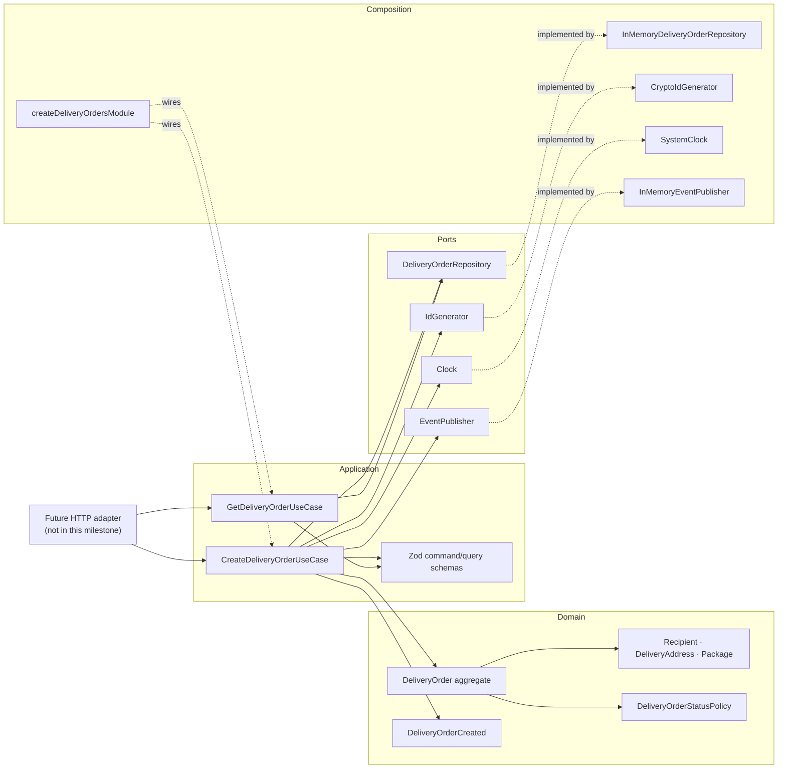
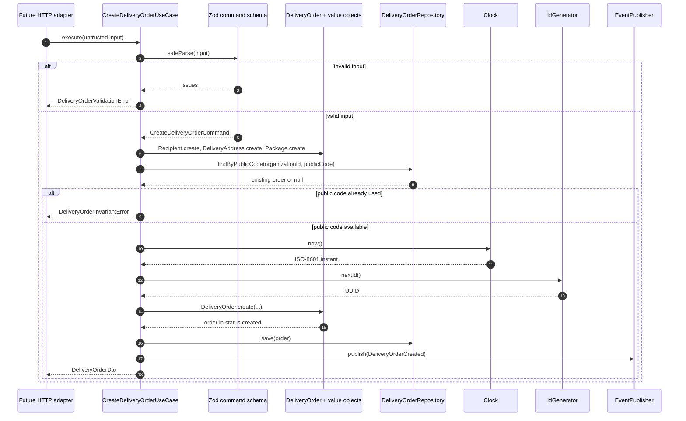
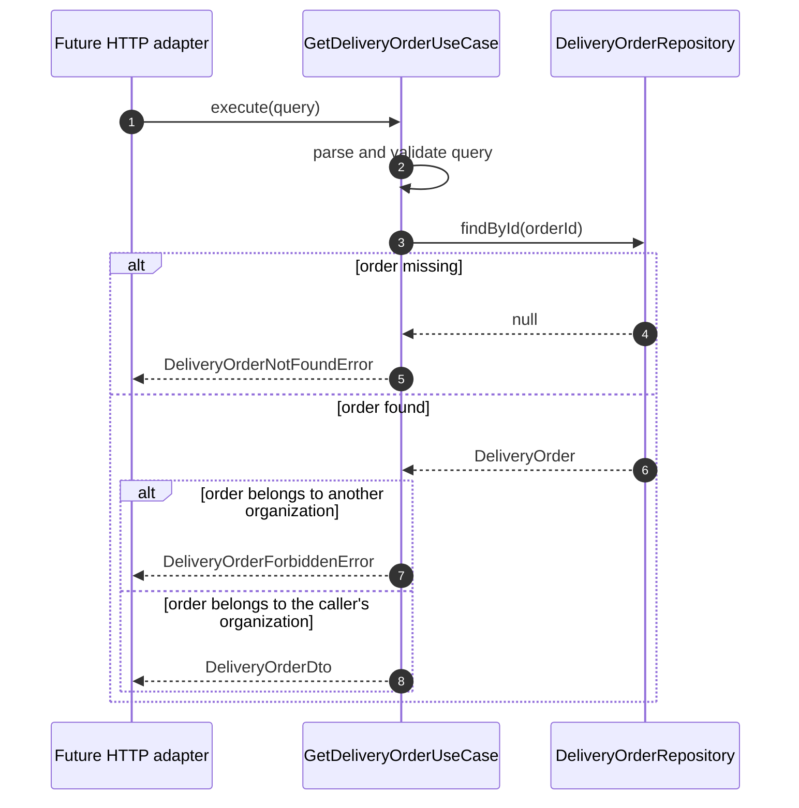

# Architecture — `delivery-orders`

The module is one hexagonal slice inside the modular monolith: a pure-TypeScript domain,
application use cases that depend on ports, and a composition root that supplies adapters.
No framework type reaches the domain, and no use case constructs its own dependencies.

## Layers

| Layer | Contents | May import |
|---|---|---|
| Domain | `DeliveryOrder`, value objects, status policy, domain event, typed errors | Shared pure helpers (`ids`, `errors`) only |
| Application | Create/get use cases, Zod command/query schemas, DTOs, ports | Domain, Node built-ins, Zod at the boundary |
| Composition | In-memory repository, crypto id generator, system clock, event recorder | Application ports/use cases, shared helpers |
| Infrastructure (future) | Express controllers, TypeORM entities/repositories, messaging adapter | Application ports and framework libraries |

Dependencies point inward. The domain never imports Zod, Express, TypeORM or an HTTP
client (ADR-001 rule 1); use cases never import a concrete adapter (rule 2).

## Components

## Ports and adapters

| Port | Purpose | Pilot adapter | Production adapter (later) |
|---|---|---|---|
| `DeliveryOrderRepository` | Save an aggregate; load by id; look up a public code per organization | `InMemoryDeliveryOrderRepository` | TypeORM repository in `infrastructure/persistence` |
| `IdGenerator` | Internal UUID generation | `CryptoIdGenerator` (`crypto.randomUUID`) | Same contract; UUIDv7 when ratified |
| `Clock` | ISO-8601 instant for `createdAt`/events | `SystemClock` | Same contract; database time policy to be decided |
| `EventPublisher` | Publish `DeliveryOrderCreated` | `InMemoryEventPublisher` (records events) | Message bus or transactional outbox |

`findById` is intentionally not tenant-filtered: the get use case must distinguish
"missing" from "another organization's order" and apply the organization check itself.
`findByPublicCode` is tenant-scoped because readable codes are unique per organization.

## Create-order flow

## Read-order flow

## Events

`DeliveryOrderCreated` is published after the aggregate is saved. It carries
`orderId`/`aggregateId`, `organizationId`, `publicCode` and `occurredAt`; recipient name
and phone are deliberately excluded from the payload.

The pilot publishes in-process and does not retry. Guarantees, replay/snapshot and a
transactional outbox are pending decisions (architecture plan §11.11), so a failed publish
can currently leave a stored order without its event. A production adapter must close that
gap before another module consumes the event.

The order-side status contract is in
[policies/DeliveryOrderStatusPolicy.ts](../domain/policies/DeliveryOrderStatusPolicy.ts)
and [business-rules.md](business-rules.md). The `delivery-execution` module will own the
use cases that produce `delivered` and `returned` outcomes.

## Transactions

| Operation | Transaction need | Status |
|---|---|---|
| Create one order | Single aggregate write plus event; safe in one transaction once persistence exists | In-memory pilot |
| Get one order | Read-only | In-memory pilot |
| Incidents + attempt + order status | Coordinated multi-aggregate write (invariant 14) | Out of scope; future `delivery-execution` |
| Order + stop + route assignment | Coordinated multi-aggregate write | Out of scope; future `delivery-routes`/`dispatch` |

Use cases, not repositories, will own transaction boundaries through a unit-of-work port
(ADR-002 §4). The in-memory adapter has no rollback semantics, so tests assert use-case
behaviour rather than durability.

## Composition

`createDeliveryOrdersModule(options)` wires defaults and returns the use cases, repository
and event recorder. Tests override the clock, id generator and event publisher with
deterministic doubles. The process-wide composition root (`apps/api/src/main.ts`) will pass
real adapters once HTTP and persistence exist; use cases stay unchanged.

## Tests

| Suite | Covers |
|---|---|
| `tests/create-delivery-order.test.ts` | Happy path, zero packages, Zod and value-object rejection, duplicate code, event emission |
| `tests/get-delivery-order.test.ts` | Owner read, cross-organization forbidden, missing order, query validation |
| `tests/delivery-order-domain.test.ts` | Aggregate invariants, immutability, value-object validation |
| `tests/delivery-order-status-policy.test.ts` | Canonical vocabulary, allowed transitions, terminal states |

## Not yet enforced in CI

- Import-boundary linting (`eslint-plugin-boundaries` or `import/no-restricted-paths`) is a
  follow-up from ADR-001; review currently protects module boundaries.
- No HTTP, database or authorization tests exist because those adapters are not built.
