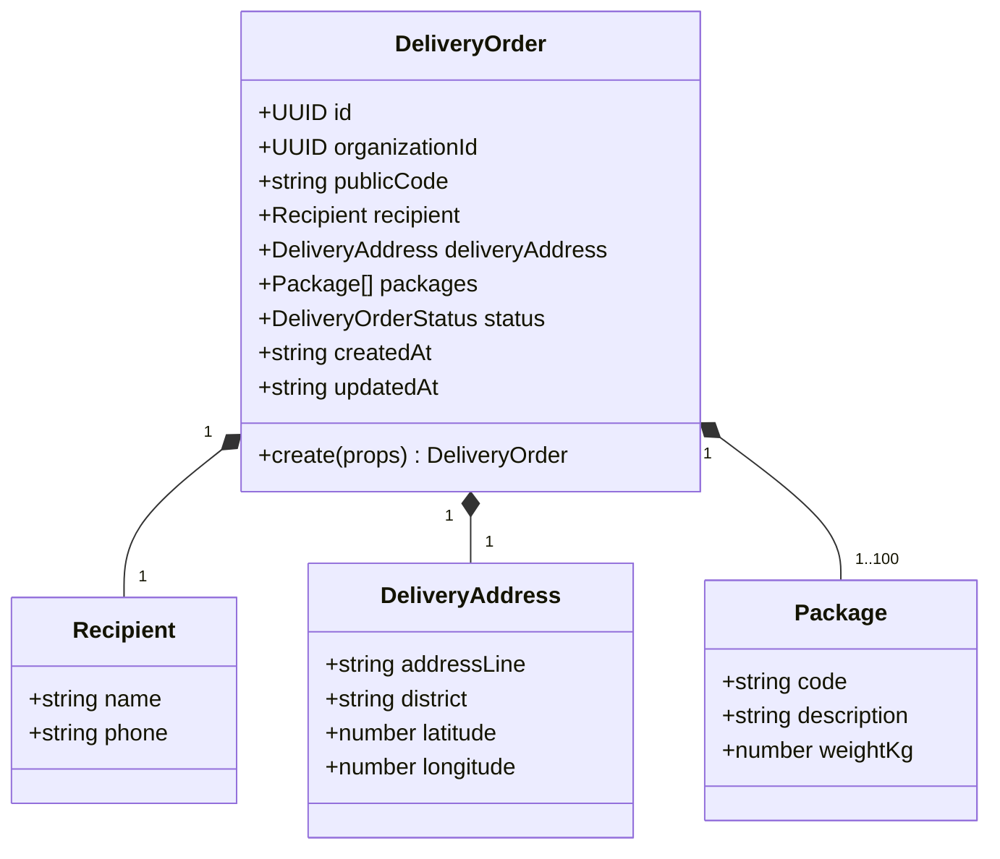

# Data model — `delivery-orders`

The aggregate is small on purpose: one root, three value objects, one status enum and one
domain event. Persistence is not implemented yet, so this document separates the current
domain contract from the intended PostgreSQL schema.

## Aggregate



`DeliveryOrder` is the only aggregate root. Packages are value objects in this pilot: they
are created with the order, cannot move between orders and are replaced only by a future
explicit use case. Their database rows still receive UUIDs when the persistence adapter is
built, but that identity is not part of the current domain contract.

## Domain entities and value objects

### `DeliveryOrder`

| Field | Type | Nullable | Rule |
|---|---|---|---|
| `id` | UUID string | No | Internal identifier; never a URL/public credential |
| `organizationId` | UUID string | No | Tenant root; every read checks it |
| `publicCode` | string | No | 3–32 uppercase letters/digits/hyphens; unique per organization; display/lookup aid only |
| `recipient` | `Recipient` | No | Value object |
| `deliveryAddress` | `DeliveryAddress` | No | Value object |
| `packages` | `readonly Package[]` | No | One or more; unique codes; frozen array |
| `status` | `DeliveryOrderStatus` | No | Starts at `created`; read-only in the pilot |
| `createdAt` | ISO-8601 string | No | Supplied by `Clock` |
| `updatedAt` | ISO-8601 string | No | Equal to `createdAt` until a transition exists |

### `Recipient`

| Field | Type | Nullable | Rule |
|---|---|---|---|
| `name` | string | No | Trimmed, 1–120 |
| `phone` | string | No | Trimmed, 6–20 characters; 6–15 digits; formatting characters allowed |

### `DeliveryAddress`

| Field | Type | Nullable | Rule |
|---|---|---|---|
| `addressLine` | string | No | Trimmed, 5–200 |
| `district` | string | No | Trimmed, 2–80; free text until a Lima catalogue exists |
| `latitude` | number | Yes | −90..90; required when longitude exists |
| `longitude` | number | Yes | −180..180; required when latitude exists |

### `Package`

| Field | Type | Nullable | Rule |
|---|---|---|---|
| `code` | string | No | 1–40; uppercase letters/digits/hyphen/underscore; unique inside the order |
| `description` | string | No | Trimmed, 1–200 |
| `weightKg` | number | Yes | Finite, > 0, ≤ 1000 |

### Status enum

```ts
type DeliveryOrderStatus =
  | 'created'
  | 'planned'
  | 'assigned'
  | 'in_transit'
  | 'delivered'
  | 'returned'
  | 'cancelled';
```

`failed` is not part of the order status. See [business-rules.md](business-rules.md) for the
ratified incident rule and [decisions.md](decisions.md) for the rationale.

## Application DTO

`DeliveryOrderDto` is the serializable output of both use cases.

| Field | Type | Notes |
|---|---|---|
| `id` | string | Internal UUID |
| `organizationId` | string | UUID |
| `publicCode` | string | Normalized uppercase |
| `status` | `DeliveryOrderStatus` | Canonical enum |
| `recipient` | `{ name, phone }` | Personal data; redact in logs |
| `deliveryAddress` | `{ addressLine, district, latitude, longitude }` | Coordinates are `number \| null` |
| `packages` | `{ code, description, weightKg }[]` | `weightKg` is `number \| null` |
| `createdAt` | string | ISO-8601 instant |
| `updatedAt` | string | ISO-8601 instant |

Optional domain values become explicit `null` in the DTO so clients do not have to
distinguish “absent key” from “unknown value”.

## Intended persistence schema (not implemented)

No migration exists in this milestone and no TypeORM entity has been written. The following
is the target shape for the persistence phase, following ADR-002 conventions.

### `delivery_order`

| Column | PostgreSQL type | Null | Constraint |
|---|---|---|---|
| `id` | `uuid` | No | Primary key |
| `organization_id` | `uuid` | No | FK `organization(id)`; indexed |
| `customer_account_id` | `uuid` | No | FK `customer_account(id)`; deferred until the customers module exists |
| `public_code` | `varchar(32)` | No | Unique `(organization_id, public_code)` |
| `status` | `text` | No | Check in canonical status values; default `created` |
| `recipient_name` | `varchar(120)` | No | |
| `recipient_phone` | `varchar(20)` | No | |
| `delivery_address_line` | `varchar(200)` | No | |
| `delivery_district` | `varchar(80)` | No | |
| `latitude` | `numeric(9,6)` | Yes | Check −90..90 |
| `longitude` | `numeric(9,6)` | Yes | Check −180..180 |
| `created_at` | `timestamptz` | No | |
| `updated_at` | `timestamptz` | No | |

Checks: `latitude` and `longitude` are both null or both present; `public_code` matches the
module format; `status` is one of the canonical values. Future columns (`active_route_id`,
`time_window`, `notes`) arrive with their own modules and migrations.

### `delivery_order_package`

| Column | PostgreSQL type | Null | Constraint |
|---|---|---|---|
| `id` | `uuid` | No | Primary key (new UUID, not exposed by the aggregate) |
| `organization_id` | `uuid` | No | FK `organization(id)`; indexed |
| `delivery_order_id` | `uuid` | No | FK `delivery_order(id)` `ON DELETE RESTRICT` |
| `code` | `varchar(40)` | No | Unique `(delivery_order_id, code)` |
| `description` | `varchar(200)` | No | |
| `weight_kg` | `numeric(10,3)` | Yes | Check `weight_kg > 0` |
| `created_at` | `timestamptz` | No | |

### Indexes

| Index | Reason |
|---|---|
| `delivery_order(organization_id, public_code)` unique | Per-tenant readable-code lookup and duplicate protection |
| `delivery_order(organization_id, status)` | Future operating lists by status |
| `delivery_order_package(delivery_order_id, code)` unique | Package code uniqueness inside the order |

## Mapping notes

- Value objects map to flattened columns; there are no JSON blobs for recipient or address.
- `weightKg` is a JavaScript number in the domain and `numeric(10,3)` in PostgreSQL. Money
  and measurement values are never stored as floating point (data-model convention).
- `timestamptz` stores the instant. Database sessions and API serialization will present
  America/Lima (`-05:00`), per the ratified timezone decision; application timestamps are
  ISO-8601 UTC strings from `Clock`.
- Aggregates are loaded and saved whole. The package collection is replaced on save rather
  than mutated row by row; the adapter owns that mapping (ADR-002 §2).
- No table stores status history yet. Audit events are a cross-cutting requirement
  (invariant 8) and will be written in the same transaction once the audit model exists.
