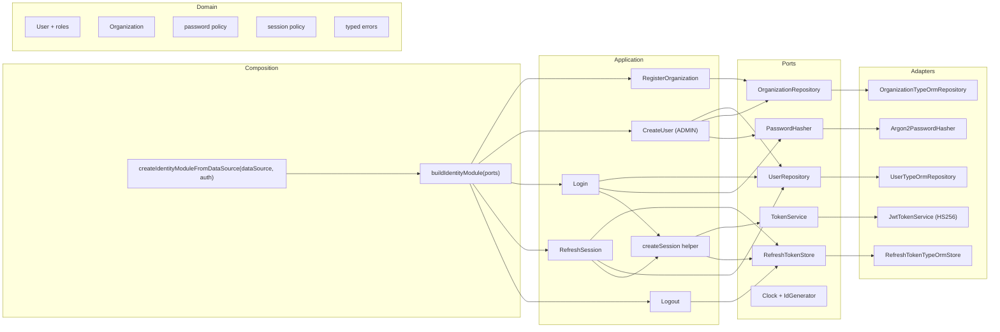
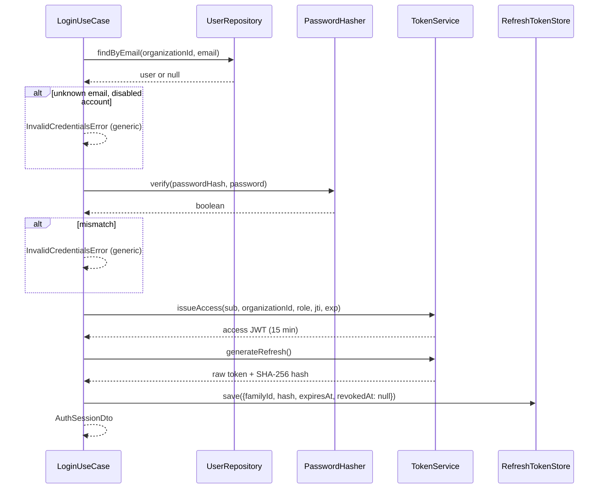
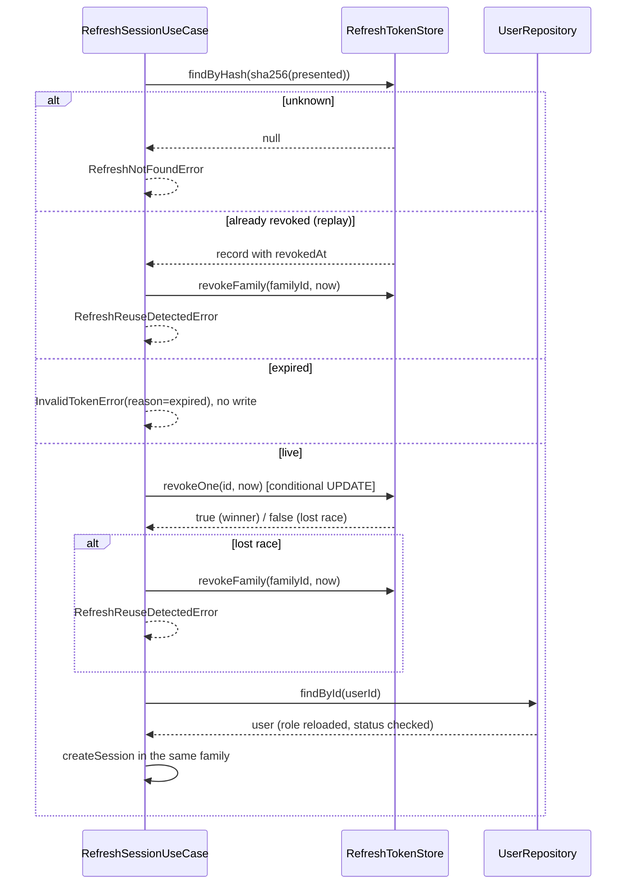

# Architecture — `identity-and-access`

The module is one hexagonal slice inside the modular monolith: pure domain rules, use cases
that depend on ports, and adapters supplied by composition. It is implemented end to end
for the application and persistence layers and deliberately has **no HTTP adapter yet**.

## Layers

| Layer | Contents | May import |
|---|---|---|
| Domain | `User`, `Organization`, password/session policies, typed errors | Shared `isUuid` and `DomainError` only |
| Application | Five use cases, Zod command schemas, DTOs, ports | Domain, Node built-ins, Zod at the boundary |
| Infrastructure | TypeORM entities/mappers/repositories, Argon2id hasher, jose token service | Application ports, domain types, framework libraries |
| Composition | In-memory wiring for tests/demo, TypeORM + security wiring for the process | Ports, use cases, adapters, shared helpers, config types |

Dependencies point inward. Use cases never construct an adapter, and no framework type
reaches the domain or application layers.

## Components

## Ports and adapters

| Port | Contract | In-memory adapter | Production adapter |
|---|---|---|---|
| `UserRepository` | `save`, `findById`, tenant-scoped `findByEmail` | `InMemoryUserRepository` | `UserTypeOrmRepository` |
| `OrganizationRepository` | `save`, `findById` | `InMemoryOrganizationRepository` | `OrganizationTypeOrmRepository` |
| `RefreshTokenStore` | `save`, `findByHash`, atomic `revokeOne`, `revokeFamily` | `InMemoryRefreshTokenStore` | `RefreshTokenTypeOrmStore` |
| `PasswordHasher` | `hash`, `verify` | test double only | `Argon2PasswordHasher` (Argon2id) |
| `TokenService` | `issueAccess`, `verifyAccess`, `generateRefresh`, `hashRefresh` | test double only | `JwtTokenService` (jose HS256) |
| `Clock` / `IdGenerator` | current instant / next UUID | `FixedClock`, `SequentialIdGenerator` | `SystemClock`, `CryptoIdGenerator` |

`buildIdentityModule` requires a hasher and a token service because neither has a safe
default: a reversible hasher or a hard-coded secret would be a security defect. Repositories,
clock and id generator default to the in-memory adapters.

## Login sequence

The refresh token is persisted **before** the DTO is returned, so a client never holds a
token the server cannot find.

## Rotation and reuse detection

`revokeOne` is the single-winner primitive: one `UPDATE ... WHERE revoked_at IS NULL`. A
second concurrent refresh of the same token receives `false` and is handled as reuse rather
than issuing a second live token.

## Consistency and transactions

- Session issuance performs two writes (access JWT is stateless, then one refresh row
  insert). A failure after the JWT is signed but before the row is stored returns an error
  to the client; no usable session exists because the refresh row is missing.
- Rotation performs two writes (revoke the presented row, insert the next row). They are
  deliberately ordered: revoke first. A crash in between logs the user out instead of
  leaving a token valid twice. ADR-003 accepts this aggressive failure mode.
- Reuse detection performs one family-wide conditional UPDATE; it is atomic per statement.
- No cross-aggregate transaction is needed in this milestone. A future unit-of-work port is
  the place for coordinated multi-row writes (ADR-002 §4).

## Configuration and composition

`loadAuthConfig` (`apps/api/src/config/config.ts`) validates `JWT_SECRET` (minimum 32
characters, no default), issuer, audience, token lifetimes, `COOKIE_SECURE` and the login
rate-limit placeholders. The process factory receives that validated object and constructs
`JwtTokenService` plus a `SessionPolicy`; it never reads `process.env` itself.

## Deliberately absent

- HTTP routes, middleware, cookies, CSRF reasoning and rate-limit enforcement (T2).
- Public OpenAPI contract for auth (T2).
- Access-token revocation lists, key rotation and JWKS.
- Cleanup job for expired refresh rows.
- Password reset/invitation delivery and user disable/enable transitions.
