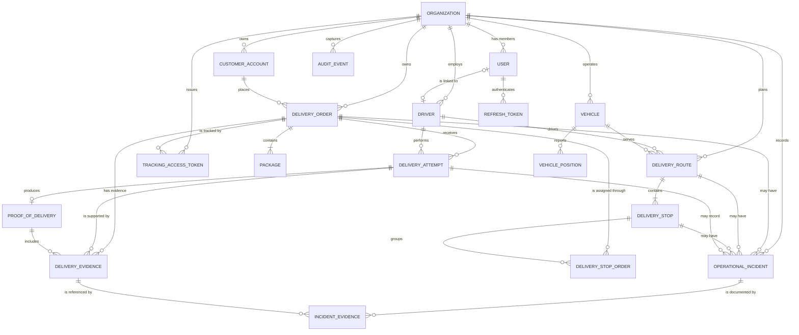

# Conceptual data model

The platform is a multi-tenant last-mile delivery ERP. This document defines the
conceptual model shared by every module: entities, relationships, key fields and the
invariants the implementation must preserve. It is derived from the architecture plan
(§5 business model, §11 ratified decisions) and is authoritative for module-level data
models until a module ADR narrows a detail.

Scope note: this is a conceptual model, not a migration. Column types, indexes and
constraints are listed as intent; each module ships its own `data-model.md` with the real
schema and migrations.

## Conventions

| Concern | Convention |
|---|---|
| Tenancy | `Organization` is the multi-tenant root. Every business row carries `organizationId`; every query filters by it; uniqueness is per organization unless stated otherwise. |
| Identifiers | Internal primary keys are UUIDs. They are not exposed in URLs, QR codes or public links. |
| Public codes | Human-readable codes (`publicCode`) exist for order, route and package and are unique per organization. They are display/lookup aids, never credentials. |
| Tracking tokens | Public tracking uses a separate high-entropy opaque token, hashed at rest (ADR-003). It is never the order code and never a JWT. |
| Timestamps | Columns are `timestamptz` (instants preserved). Database sessions, API serialization, logs and audit present `America/Lima`. Calendar-only values use `date`. |
| Naming | English, `snake_case` in the database, singular table names, domain names in PascalCase. |
| Money and measurements | Decimal types (`numeric`), never floating point. |
| Evidence binaries | Stored in S3-compatible object storage (MinIO in the demo); PostgreSQL stores metadata only (§9A). |
| Audit | Every state-changing operation writes an `AuditEvent` in the same transaction (invariant 8). |

Timezone detail: the ratified decision is America/Lima for database, API, UI, logs and
audit. Lima has no daylight saving time, which keeps the mapping stable. Instants are
written as `timestamptz` so the same moment is preserved; presentation and serialization
use the `America/Lima` offset (`-05:00`). The API accepts ISO-8601 timestamps with an
offset and normalizes them before persistence.

## Entity relationships

Supporting identity and audit entities (`USER`, `REFRESH_TOKEN`, `AUDIT_EVENT`) are
required by the ratified authentication policy (ADR-003) and the audit invariant; they
are not part of the §5 business list.

## Entities

### Tenancy and identity

**Organization** — multi-tenant root.

- Key fields: `id`, `name`, `slug` (globally unique), `timezone` (default
  `America/Lima`), `status`, `createdAt`, `updatedAt`.
- Invariants: every other aggregate references exactly one organization; no operation
  reads or writes across organizations; the organization is the root of every
  authorization decision.

**User** — authenticated operator or driver account.

- Key fields: `id`, `organizationId`, `email` (unique per organization,
  case-insensitive), `passwordHash` (Argon2id), `role` (`ADMIN`, `DISPATCHER`,
  `DRIVER`), `status`, `lastLoginAt`, `createdAt`.
- Invariants: users are created only through an ADMIN invitation (plan §11.2); a
  `DRIVER` user links to at most one `Driver` in the same organization; role and
  membership are reloaded per request, never trusted from the token alone; the password
  hash is never serialized or logged.

**RefreshToken** — rotating refresh-token chain per device session.

- Key fields: `id`, `organizationId`, `userId`, `tokenHash`, `issuedAt`, `expiresAt`,
  `rotatedFromId` (nullable), `revokedAt` (nullable), `reuseDetectedAt` (nullable).
- Invariants: only the hash is stored; each token is consumable once; a reused token
  revokes the whole chain (ADR-003); expiry is absolute at 7 days; logout revokes the
  current chain only.

**AuditEvent** — append-only audit trail for state changes.

- Key fields: `id`, `organizationId`, `actorUserId` (nullable for public/system
  actions), `action`, `entityType`, `entityId`, `before` / `after` (redacted JSON),
  `occurredAt`, `correlationId`.
- Invariants: written in the same transaction as the state change; append-only; no
  secrets or raw PII in payloads; `occurredAt` presented in America/Lima.

### Customers and orders

**CustomerAccount** — company that contracts delivery services.

- Key fields: `id`, `organizationId`, `publicCode`, `name`, `contactName`,
  `contactEmail`, `contactPhone`, `status`, `createdAt`.
- Invariants: scoped to one organization; `publicCode` unique per organization; the
  customer has no authenticated access in the MVP (public tracking only, plan §11.2).

**DeliveryOrder** — an order to be transported, with recipient and delivery address.

- Key fields: `id`, `organizationId`, `customerAccountId`, `publicCode`, `status`,
  `recipientName`, `recipientPhone`, `deliveryAddressLine`, `deliveryDistrict`,
  `latitude` / `longitude` (nullable), `timeWindow` (`AM` / `PM`), `activeRouteId`
  (nullable), `notes`, `createdAt`, `updatedAt`.
- Working status set (canonical vocabulary is fixed by the `delivery-orders` module):
  `created`, `planned`, `assigned`, `in_transit`, `delivered`, `failed`, `returned`,
  `cancelled`. `delivered` and `returned` are ratified outcomes.
- Invariants: at most one active route at a time (single `activeRouteId`); confirmation
  is per order, even when orders share a stop (invariants 4, 9); delivery confirmation
  never depends on GPS movement (invariant 4); any delivery incident moves the order to
  `returned` (invariant 14); every status change is audited (invariant 8); recipient PII
  is redacted in logs.

**Package** — a physical parcel belonging to an order.

- Key fields: `id`, `organizationId`, `deliveryOrderId`, `code` (unique per order),
  `description`, `weightKg` (nullable, decimal), `createdAt`.
- Invariants: an order has one or more packages (plan §11.3); packages never belong to
  two orders; a package is not a delivery unit of its own in the MVP — attempts and
  proof of delivery are recorded at order level, while evidence can reference the
  order and its packages operationally.

### Dispatch and fleet

**Driver** — person who executes routes.

- Key fields: `id`, `organizationId`, `userId` (nullable), `fullName`,
  `documentNumber`, `phone`, `licenseNumber`, `status`, `createdAt`.
- Invariants: at most one active route at a time; assignments must be compatible with
  vehicle and availability (invariant 3); personal data is not exposed by public
  tracking.

**Vehicle** — fleet unit and availability.

- Key fields: `id`, `organizationId`, `plate` (unique per organization), `type`,
  `capacityKg` (nullable), `status`, `createdAt`.
- Invariants: at most one active route at a time; a vehicle cannot be assigned to
  incompatible active routes (invariant 3).

**DeliveryRoute** — planned and executed run of one vehicle and one driver.

- Key fields: `id`, `organizationId`, `publicCode`, `plannedDate` (`date`), `driverId`,
  `vehicleId`, `status` (`planned`, `in_progress`, `completed`, `cancelled`),
  `startedAt`, `completedAt`.
- Invariants: a route has one or more stops (invariant 1); exactly one driver and one
  vehicle; a route is completed explicitly, never as a side effect of the last delivery
  (invariant 5); state transitions are audited.

**DeliveryStop** — sequenced physical stop with coordinates.

- Key fields: `id`, `organizationId`, `routeId`, `sequence`, `addressLine`,
  `latitude`, `longitude`, `status` (`pending`, `arrived`, `completed`, `failed`,
  `skipped`), `plannedArrivalAt` (nullable).
- Invariants: `(routeId, sequence)` is unique; a stop can hold several orders
  (invariant 1); each order's outcome is independent of the others on the same stop
  (invariant 9); coordinates are optional for confirmation.

**DeliveryStopOrder** — assignment of an order to a stop.

- Key fields: `id`, `organizationId`, `stopId`, `orderId`, `createdAt`.
- Invariants: an order appears in at most one active stop/route (invariant 2); the join
  exists so a stop can carry multiple orders; the assignment is transactional with
  `DeliveryOrder.activeRouteId`.

**VehiclePosition** — GPS reading with capture and reception timestamps.

- Key fields: `id`, `organizationId`, `vehicleId`, `recordedAt`, `receivedAt`,
  `latitude`, `longitude`, `accuracyMeters` (nullable), `speedKph` (nullable), `source`
  (`simulated`, `device`).
- Invariants: append-only; `recordedAt` and `receivedAt` are distinct; a stale position
  is displayed as last known, never as current (invariant 7); GPS never confirms a
  delivery (invariant 4); retention policy is pending (plan §11.17).

### Execution and evidence

**DeliveryAttempt** — result of one delivery attempt.

- Key fields: `id`, `organizationId`, `orderId`, `routeId`, `stopId`, `driverId`,
  `attemptNumber`, `status` (`succeeded`, `failed`), `startedAt`, `finishedAt`
  (nullable), `failureReason` (nullable), `notes`.
- Invariants: one terminal outcome per attempt; a successful attempt requires at least
  one valid evidence file (invariant 10); a registered delivery incident marks the
  attempt failed (invariant 14); there are no field retries — a new attempt requires a
  new dispatcher assignment (plan §11.4); confirmation is independent of GPS
  (invariant 4).

**ProofOfDelivery** — delivery record for one order and attempt.

- Key fields: `id`, `organizationId`, `orderId`, `attemptId` (unique), `recipientName`
  (nullable), `deliveredAt`, `latitude` / `longitude` (nullable), `notes` (nullable),
  `createdByUserId`.
- Invariants: at most one per successful attempt; requires at least one available
  evidence file (invariant 10); location is optional and never proves delivery by
  itself; binaries are not stored here.

**DeliveryEvidence** — metadata for a photo attached to a delivery or incident.

- Key fields: `id`, `organizationId`, `orderId`, `attemptId` (nullable), `incidentId`
  (nullable), `objectKey`, `mimeType`, `byteSize`, `checksum`, `status`
  (`pending_upload`, `available`), `uploadedByUserId`, `createdAt`, `exifStrippedAt`
  (nullable).
- Invariants: metadata only, the object lives in S3/MinIO; `objectKey` is
  server-generated; attaching evidence alone never changes an order state
  (invariant 12); only `available` evidence satisfies the photo requirement;
  public tracking exposes only explicitly permitted evidence (invariant 13); initial
  limits of 5 MB and 5 files per delivery/incident are a proposal pending ratification
  (plan §11.19).

**IncidentEvidence** — relation between an incident and its evidence files.

- Key fields: `id`, `organizationId`, `incidentId`, `evidenceId`, `createdAt`.
- Invariants: an incident can cite several files; evidence and incident must belong to
  the same organization and related order/route; incident photos are not exposed by
  default in public tracking.

### Incidents and tracking

**OperationalIncident** — operational event or delivery incident.

- Key fields: `id`, `organizationId`, `orderId` (nullable), `stopId` (nullable),
  `routeId` (nullable), `category` (`recipient_absent`, `incorrect_address`,
  `delivery_refused`, `damaged_package`, `access_restricted`, `vehicle_issue`,
  `other`), `description`, `reportedByUserId`, `reportedAt`, `status`
  (`open`, `closed`).
- Invariants: at least one of order/stop/route is set; a delivery incident requires
  category, description and at least one evidence file, unless an audited exception is
  authorized (invariant 11); registering a delivery incident marks the attempt failed
  and the order `returned` in the same transaction (invariant 14); "recipient did not
  answer" uses `other` (plan §11.4); incidents are audited.

**TrackingAccessToken** — revocable public permission for one order.

- Key fields: `id`, `organizationId`, `orderId`, `tokenHash`, `expiresAt`,
  `revokedAt` (nullable), `createdAt`, `lastAccessedAt` (nullable).
- Invariants: opaque token with at least 128 bits of entropy (256 recommended),
  CSPRNG-generated, URL-safe; stored as a hash; not a JWT and not the order code;
  scoped to exactly one order; expiry and revocation take effect immediately; the
  response never reveals other orders, stops, customers, drivers or internal evidence
  (invariant 6); access is rate limited and links are treated as bearer secrets.

## Priority invariants

| # | Invariant (architecture plan §5) | Enforcement intent |
|---|---|---|
| 1 | A route has one or more stops; a stop can hold several orders. | Route/stop and stop/order use-case validation plus FK constraints. |
| 2 | An order is never in two active routes at once. | Single nullable `delivery_order.active_route_id`; assignment in a transaction. |
| 3 | A vehicle/driver has no incompatible active assignments. | Partial unique indexes on `delivery_route(driver_id)` and `delivery_route(vehicle_id)` where status is `planned`/`in_progress`. |
| 4 | Delivery confirmation is independent of GPS movement. | The confirm-delivery use case never reads `VehiclePosition`; proof coordinates are optional. |
| 5 | Delivering an order does not end the route. | Explicit complete-route use case; no cascade from the last order. |
| 6 | Public tracking never reveals other orders/stops/customers. | Token-to-order scoping in the query and a whitelisted response projection. |
| 7 | A stale position is shown as last known, not current. | Expose `recordedAt`/`receivedAt` and a staleness flag; UI labels the position. |
| 8 | Every state-changing operation is audited. | `AuditEvent` written in the same transaction as the change. |
| 9 | Confirmation is per order even when orders share a stop. | Attempts and proofs are keyed by `orderId`, never by `stopId` alone. |
| 10 | A confirmed delivery requires at least one valid photo, unless an audited exception. | Confirmation transaction checks for at least one `available` evidence row. |
| 11 | A delivery incident requires category, description and at least one photo, unless an audited exception. | Zod validation plus use-case check plus evidence link in the same transaction. |
| 12 | Attaching evidence does not by itself change order state. | Evidence upload is a separate use case with no status update. |
| 13 | The public client sees only explicitly permitted evidence. | Public DTO allow-list; incident photos hidden by default. |
| 14 | Every delivery incident marks the attempt failed and returns the order to the warehouse (`returned`); no field retries. | Single transaction: incident + attempt `failed` + order `returned`; a new attempt requires a new dispatch decision. |

> **Ratified incident policy (plan §11.4).** Any registered delivery incident marks the
> attempt as failed and returns the order to the warehouse (`returned`). There are no
> field retries in the MVP: a new delivery is a new dispatcher decision. "Recipient did
> not answer" is recorded with the `other` category, not a dedicated category.

## Cross-cutting implementation notes

- **Tenant enforcement**: repository adapters require `organizationId` on every read and
  write, and use cases verify membership and resource ownership before touching data
  (ADR-003). Cross-organization requests return not found.
- **Transactions**: order + stop + route changes, incident + attempt + order status, and
  delivery confirmation + proof + evidence check are single transactions (ADR-001 rule
  10, ADR-002 §4).
- **Conflict surfaces**: `(route_id, sequence)` unique; active order/route assignment
  unique; active driver/route and vehicle/route unique; `package(order_id, code)`
  unique; `tracking_access_token(token_hash)` unique; `proof_of_delivery(attempt_id)`
  unique.
- **Deletion**: operational records are not hard-deleted while referenced by audit or
  evidence. Soft status/archival lifecycle replaces deletion; evidence retention follows
  plan §11.19.
- **Timezone**: all timestamps `timestamptz`; `plannedDate` is a Lima calendar date;
  `timeWindow` stays `AM`/`PM` until the window model is extended (plan §11.3).

## Open questions

| Topic | Status |
|---|---|
| UUIDv4 vs UUIDv7 for internal ids (§11.9) | Pending; model is version-agnostic. |
| PostGIS adoption for stop/position geometry (§11.10) | Recommended, pending ADR update. |
| Canonical order status vocabulary | Fixed by the `delivery-orders` module; model lists a working set. |
| Evidence formats, size limits and retention (§11.19) | Pending; 5 MB / 5 files is a proposal. |
| Audit storage and retention (§11.12) | Pending; `AuditEvent` is the conceptual shape only. |
| Public tracking detail window (§8) | Pending. |
